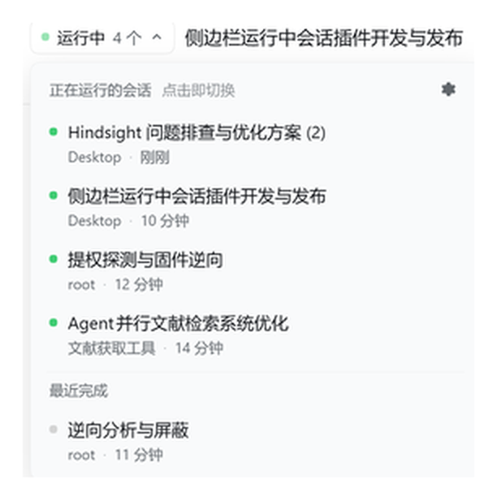

# 运行中会话胶囊 · dsh-running-sessions

<div align="center">

[](https://github.com/ERroooooR/dsh-running-sessions/blob/main/LICENSE)
[](https://github.com/deepseek-ai/deepseek-harness)
[](#安装)
[](https://github.com/ERroooooR/dsh-running-sessions/stargazers)

<p>
  
</p>
<p>
  
  
</p>

</div>

会话标题左侧一枚胶囊 `● 运行中 3 个 ▾`：点开是所有工作区里正在跑的会话，再点一行就切过去。

**子 agent 不算独立会话。**它们缩进挂在所属会话下面，所以一个开了五个子 agent 的对话仍然只占一行；主 agent 停了、子 agent 还在跑时，那条会话仍算运行中。

## 安装

**dsh web** —— 现在就能用，`client.js` 已预构建，安装时不跑构建脚本：

```sh
dsh plugin --profile web add github:ERroooooR/dsh-running-sessions
```

**桌面应用** —— 桌面端 profile 由应用托管，在应用里让 DSH 装：

```powershell
plugin_manager install_bundle(target="<本仓库的绝对路径>")
```

装完 `Ctrl+R` 重载（web 端硬刷新 `Ctrl+Shift+R`）。

> npm 包名 `dsh-running-sessions` 已预留、**尚未发布**；发布后可用 `dsh plugin add dsh-running-sessions`。见 [RELEASING.md](RELEASING.md)。

## 使用

| 想做什么 | 怎么做 |
| --- | --- |
| 切到运行中 / 刚结束的会话 | 点胶囊 → 点那一行 |
| 关掉下拉 | 再点胶囊 / `Esc` / 点空白处 |
| 键盘操作 | 打开后首行自动聚焦，`Tab` 移动，回车切换 |
| 改设置 | 下拉右上角推子图标 |

没有会话在跑时胶囊会自动隐藏，标题栏保持干净。

## 设置

七项，改完立刻生效。存在浏览器 `localStorage`，不写 profile 文件，所以不用重载：

| 设置 | 默认 |
| --- | --- |
| 没有运行中会话时也显示胶囊 | 关 |
| 最近完成显示几条（`0 / 1 / 3 / 5`） | 3 |
| 显示工作区 | 开 |
| 显示时间 | 开 |
| 显示待处理标记 | 开 |
| 子 agent 活动算作会话运行中 | 开 |
| 在主会话下面列出子 agent | 开 |

## 只算主 agent

DSH 让每个子 agent 跑在自己的 Session 里，会话列表又把它和普通会话平铺在一起 —— 一个 agent 开五个子 agent，看着就像六个会话在跑。

这里的判定只认快照上可证的血缘：`origin: 'subagent'` 是身份依据（普通分叉带 `parentId` 但不是子 agent），`parentId` 给归属，父会话的 `subagentCatalog` 补上还没进列表的子会话并给出显示名（DSH 给子会话填的标题是任务提示词的开头，不能直接当行标题）。

放在 `conversation.header.leading` 而不是侧边栏：那一层只有品牌位、面板图标和已被工作区浏览器占满的 `sidebar.workspaces`，而这里是官方预留、不跟任何插件抢位。

## 兼容性

- **DSH 0.2.2-rc.3**（Windows 桌面端）实测；只用官方三个只读快照钩子和 `ctx.slots` / `ctx.locale` / `uiWorkspace.openSession`。
- 对 DSH 的依赖全收在 `src/contract.js` 一个文件里，升级只改它，`test/contract.test.mjs` 会指出哪条假设失效。
- 读取器都是防守式的：字段缺失退化成"没有数据"，最坏是胶囊消失，不是标题栏崩掉。

## 已知限制

- 只能列出客户端已加载的会话，启动后几秒内可能不全。
- 相对时间每 30 秒刷新一次，最多滞后半分钟。
- 深色主题只用 token 适配过，没做像素级验证。
- 每个主会话下最多列 6 条子 agent，多出的显示 `+N`；计数不受这个上限影响。

## 开发

`src/` 是 22 个 CommonJS 模块，`client.js` 由 `node build.mjs` 生成 —— `window.__ModuleLoader__.load` 只能收一个 classic script，所以产物必须是单文件。

```sh
node build.mjs    # 重新生成 client.js
npm test          # 106 项：产物同步 + 六个套件
```

三条约束由测试守住，不是靠自觉：DSH 字段名只能出现在 `contract.js`；只有 `platform.js` 能 `require` react；只有 `platform.js` / `style.js` 能碰 `window` / `document`。

两个实机上踩过的坑：标题栏是窗口拖动面，必须在 `window` **捕获阶段**接管 `pointerdown`，按钮上的冒泡监听收不到；切换会话会重建 header 组件，展开状态得放模块级（`mount-state.js`）。

## 许可证

[MIT](./LICENSE)
