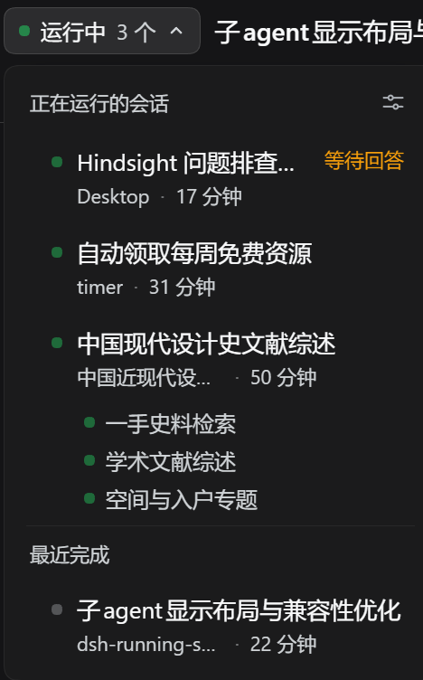
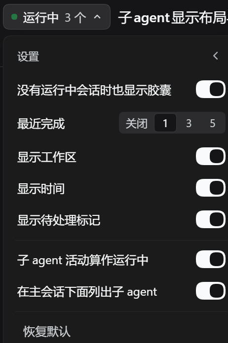

# 运行中会话胶囊 · dsh-running-sessions

<div align="center">

[](https://github.com/ERroooooR/dsh-running-sessions/blob/main/LICENSE)
[](https://github.com/deepseek-ai/deepseek-harness)
[](#安装)
[](https://github.com/ERroooooR/dsh-running-sessions/stargazers)

<p>
  
</p>
<p>
  
  
</p>

</div>

会话标题左侧一枚胶囊 `● 运行中 3 个 ▾`：点开是所有工作区里正在跑的会话，再点一行就切过去。子 agent 不单独占一行，缩进挂在所属会话下面。

## 安装

**dsh web** —— `client.js` 已预构建，安装时不跑构建脚本：

```sh
dsh plugin --profile web add github:ERroooooR/dsh-running-sessions
```

**桌面应用** —— 桌面端 profile 由应用托管，在应用里让 DSH 装：

```powershell
plugin_manager install_bundle(target="<本仓库的绝对路径>")
```

装完 `Ctrl+R` 重载（web 端硬刷新 `Ctrl+Shift+R`）。

也可以从 npm 装：`dsh plugin add dsh-running-sessions`。

## 使用

| 想做什么 | 怎么做 |
| --- | --- |
| 切到运行中 / 刚结束的会话 | 点胶囊 → 点那一行 |
| 关掉下拉 | 再点胶囊 / `Esc` / 点空白处 |
| 键盘操作 | 打开后首行自动聚焦，`Tab` 移动，回车切换 |
| 改设置 | 下拉右上角推子图标 |

没有会话在跑时胶囊会自动隐藏。

## 设置

七项，改完立刻生效，不用重载：

| 设置 | 默认 |
| --- | --- |
| 没有运行中会话时也显示胶囊 | 关 |
| 最近完成显示几条（`0 / 1 / 3 / 5`） | 3 |
| 显示工作区 | 开 |
| 显示时间 | 开 |
| 显示待处理标记 | 开 |
| 子 agent 活动算作会话运行中 | 开 |
| 在主会话下面列出子 agent | 开 |

## 兼容性

- DSH 0.2.2-rc.3，Web 端与桌面端。
- 快照字段缺失时插件退化成不显示胶囊，不影响标题栏其它部分。

## 已知限制

- 只能列出客户端已加载的会话，启动后几秒内可能不全。
- 相对时间最多滞后半分钟。
- 每个主会话下最多列出 6 条子 agent，多出的显示 `+N`。

## 开发

`src/` 是 22 个 CommonJS 模块，`client.js` 由 `node build.mjs` 打包成单文件后提交。

```sh
node build.mjs    # 重新生成 client.js
npm test          # 106 项
```

## 许可证

[MIT](./LICENSE)
